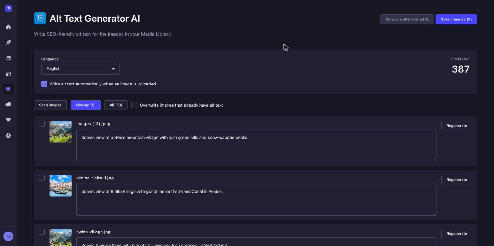
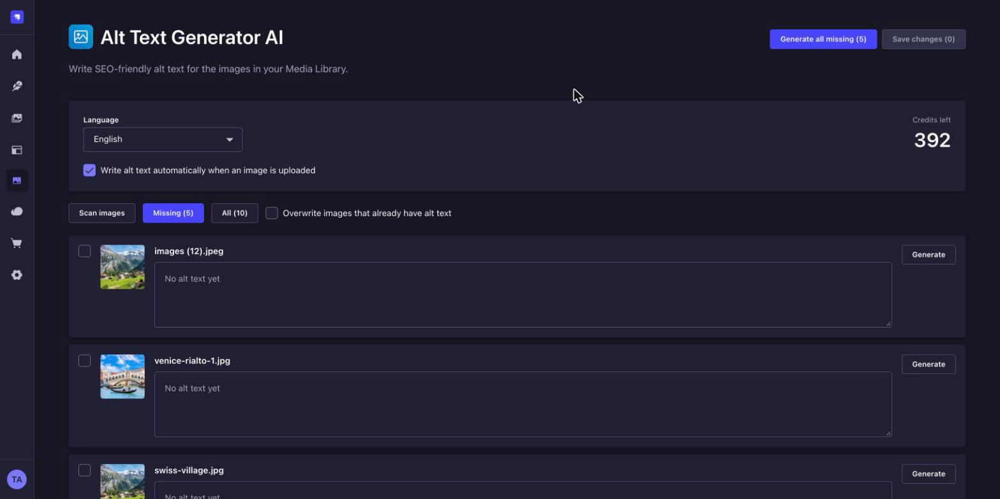
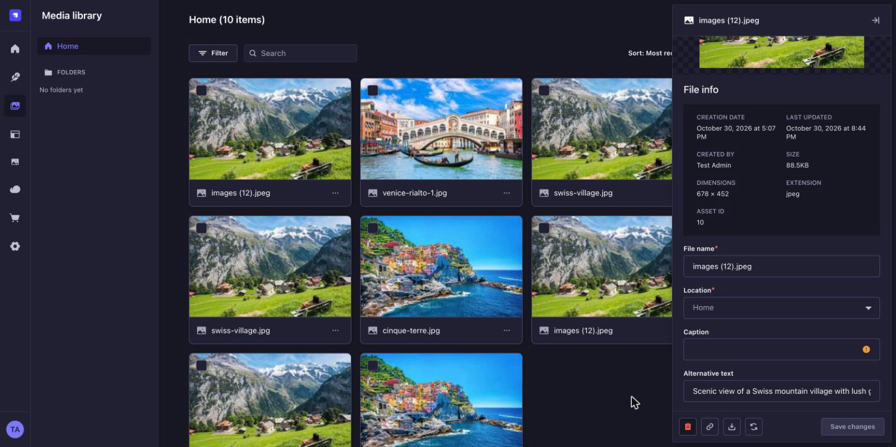

# Alt Text Generator for Strapi


Write SEO-friendly alt text for the images in your Strapi Media Library. Generate it for one image, for a selection, for every image that is missing it, or automatically when an image is uploaded. 131 languages. Works on every Strapi edition, including the free Community edition.

[Get a free API key](https://alttextgeneratorai.com/dashboard)



## What you get

- **A bulk page.** An **Alt Text Generator** link appears in the admin menu. It scans your Media Library, lists the images that have no alt text, generates it for all of them or only the ones you tick, lets you edit the results, and saves them together.
- **Automatic mode.** Turn it on and new uploads get alt text the moment they are uploaded. Replacing an image's file writes new alt text for the new picture.
- **131 languages.** Pick the language of the alt text.
- **Saved where Strapi keeps it.** The text goes in each file's **Alternative text** field, so it works with every API response and every front end you already have.
- **Credits shown in the admin.** One credit writes alt text for one image. New accounts get free credits.
- **Your key stays on your server.** The API key is only used by the plugin's server code and never reaches the browser.

## Requirements

- Strapi 5 (tested on 5.60 with SQLite and local file storage)
- Node.js 20 or newer
- An Alt Text Generator API key ([get one free](https://alttextgeneratorai.com/dashboard))

## Install

```sh
npm install @balt1794/strapi-plugin-alt-text-generator
```

Add your key to the `.env` file of your Strapi project:

```
ALT_TEXT_GENERATOR_API_KEY=your-key-here
```

Restart Strapi. If you start it with `npm run develop`, the admin rebuilds by itself. If you serve a built admin, run `npm run build` first.

The plugin enables itself. To change its options, add it to `config/plugins.ts`:

```ts
export default ({ env }) => ({
  'alt-text-generator': {
    enabled: true,
    config: {
      apiKey: env('ALT_TEXT_GENERATOR_API_KEY'),
      autoGenerate: true, // optional, can also be switched in the admin
      language: 'english', // optional, can also be changed in the admin
    },
  },
});
```

There is no database change and nothing to migrate. Settings are kept in Strapi's own settings store.

### In production

A `.env` file is for local work. On a live server, set `ALT_TEXT_GENERATOR_API_KEY` as an environment variable where your site runs, then redeploy or restart:

- **Strapi Cloud:** Settings → Variables.
- **Railway, Render, Fly.io, Heroku, DigitalOcean:** the service's environment variables page.
- **Docker or a VPS:** an `environment:` entry, `docker run -e`, or your process manager's env file.

Strapi's `config/plugins.ts` above reads the same variable, so nothing else needs to change. Never commit the key to Git.

## Where to find it in the admin

An **Alt Text Generator AI** link (with an image icon) is added to the left menu. It opens the plugin page. Only admin users who can read the Media Library see it.

## Use it

### Many images

1. Open **Alt Text Generator** in the menu. It scans your images.
2. **Missing** shows images with no alt text. **All** shows everything.
3. Tick the images you want, or leave all unticked.
4. Click **Generate selected** or **Generate all missing**.
5. Read the results, change anything you like, then click **Save changes**.

**Generate all missing** skips images that already have alt text. Tick an image to generate it anyway, or turn on **Overwrite images that already have alt text**. Click **Regenerate** on a single image to write it again.



### Where the alt text goes

The text is saved in the **Alternative text** field of each file, the same field you see when you open an image in the Media Library.



### On upload

Tick **Write alt text automatically when an image is uploaded**. From then on, every image that is uploaded without alt text gets it right away, in the language you chose. If you replace the file of an image in the Media Library, the plugin writes new alt text for the new picture.

The setting is saved in the database, so you can change it without editing code.

### Use the alt text on your site

Read the file's `alternativeText` through the Strapi API and use it as the image's `alt`:

```html

```

## Options

| Option | Default | What it does |
| --- | --- | --- |
| `apiKey` | `ALT_TEXT_GENERATOR_API_KEY` | Your API key. Prefer the environment variable. |
| `autoGenerate` | `false` | Starting value for automatic mode. Whatever an admin saves on the plugin page takes over. |
| `language` | `english` | Starting language. Whatever an admin saves takes over. |

## Strapi's built-in AI

Strapi has its own AI captions in the Media Library. It needs a paid Strapi license. This plugin does not, and it does not use Strapi's AI. If you use both, the plugin only fills images that have no alt text yet.

## Privacy

When you generate alt text, a resized copy of the image (JPEG, up to 1024 px) and your API key are sent from your Strapi server to `alttextgeneratorai.com`. Images are not stored by the plugin. Nothing is sent from the browser.

## Troubleshooting

| What you see | What to do |
| --- | --- |
| No **Alt Text Generator** link in the menu | Restart Strapi, and run `npm run build` if you serve a built admin. Check that your admin role can read the Media Library. |
| "Add your API key" notice | Set `ALT_TEXT_GENERATOR_API_KEY` in `.env` and restart. |
| "Invalid API key" | Copy the key again from your [dashboard](https://alttextgeneratorai.com/dashboard). |
| "No credits left on this API key" | Add credits at [alttextgeneratorai.com](https://alttextgeneratorai.com). |
| Alt text is not written on upload | Make sure the automatic box is ticked, the file is an image (JPEG, PNG, WebP, GIF or AVIF) and the key has credits. Strapi's log shows the reason. |

## Support

support@alttextgeneratorai.com, or open an issue on [GitHub](https://github.com/balt1794/strapi-plugin-alt-text-generator/issues).

## License

[MIT](LICENSE) © Bryam Loaiza
